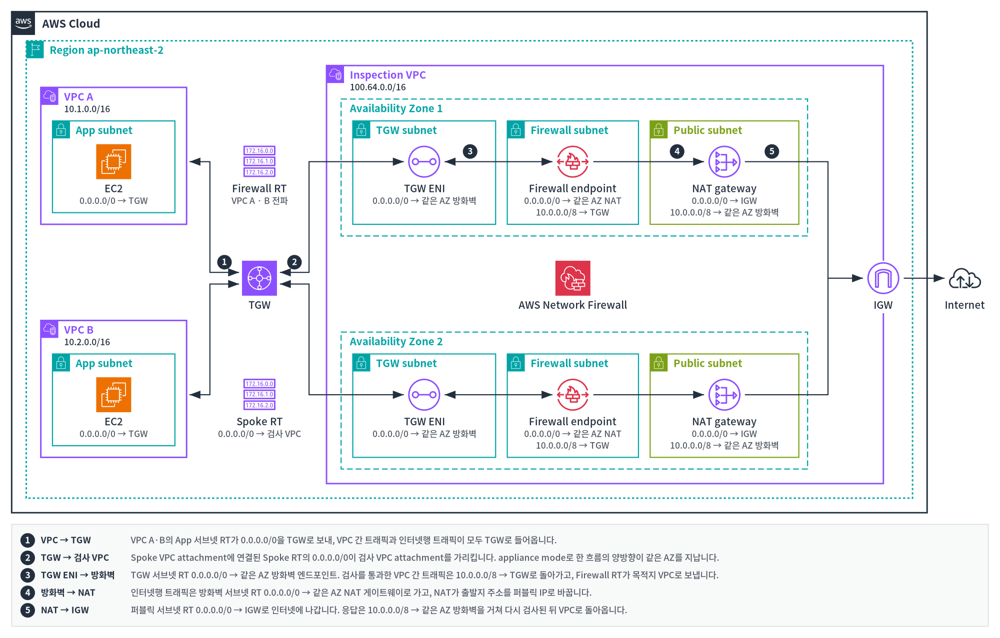

# skill-aws-arch-diagram

> English: [README.en.md](README.en.md)

개인이 만든 비공식 [Claude Code](https://claude.com/claude-code) skill입니다. AWS가 공개하는
[AWS Architecture Icons](https://aws.amazon.com/architecture/icons/)를 써서 AWS 아키텍처 구성도를
그립니다. 손으로 흉내 낸 아이콘이나 텍스트 박스 대신 실제 서비스·리소스·그룹 아이콘을 쓰고,
레이아웃 하나로 **SVG**, **PNG**, 편집 가능한 **PowerPoint 덱**을 원하는 조합으로 만듭니다.

AWS가 만들거나 보증한 도구가 아닙니다. 아이콘은 AWS 소유이며 설치할 때 AWS에서 직접
받습니다([라이선스](#라이선스) 참고).


지키는 규칙:

- 모든 서비스와 **모든 네트워킹 리소스**(Internet gateway, NAT gateway, VPC 엔드포인트,
  라우팅 테이블, 로드 밸런서)를 공식 아이콘으로 그립니다. Site-to-Site VPN, TGW peering 같은
  연결도 아이콘으로 그리고, 연결선 라벨에는 프로토콜만 씁니다. 아이콘은 기억에 의존하지 않고
  설치할 때 AWS에서 받은 공식 아이콘 패키지에서 이름으로 찾습니다.
- AWS의 중첩 규칙(AWS Cloud > Region > VPC > 서브넷)을 따르고, 그룹 테두리 색과 점선
  모양은 공식 패키지와 PowerPoint 툴킷에서 가져옵니다. 아이콘이 없는 그룹(Availability
  Zone, 보안 그룹)도 포함합니다.
- 모든 노드의 아이콘 크기는 하나로 통일합니다. Internet gateway와 가상 프라이빗 게이트웨이는
  VPC 경계선 위 가운데에 두고, 아이콘과 라벨 뒤의 경계선은 가립니다.
- 트래픽은 왼쪽에서 오른쪽으로 흐릅니다(티어는 열, AZ는 행). ALB/NLB/GWLB는 AZ에 걸친
  노드 하나로 그리고, AZ별 리소스는 AZ마다 그립니다. 경로가 돌아가면 단계 번호를 붙입니다.
- 공식 그룹 스타일(직각 모서리), 내용에 맞춘 컨테이너, 읽기 쉬운 14px/12px 글자를 씁니다.
- 초안은 PowerPoint 도형과 1:1로 대응하는 SVG 부분 집합(rect, image, text, line,
  polyline, circle)으로 그리고, 내보내기 전에 선이 라벨이나 아이콘을 지나가는지 검사합니다.
- `export.py`는 원하는 형식을 조합해 씁니다: 모든 아이콘을 base64로 넣은 SVG, PNG,
  그리고 컨테이너·연결선·라벨은 PowerPoint 도형이고 아이콘은 공식 SVG인 16:9 덱입니다.
  슬라이드 글자는 10pt 이상으로 유지합니다(피할 수 없을 때만 8pt까지).

## 참조 예제

[`docs/examples/`](docs/examples/)에 이 skill로 그린 완성 구성도(SVG + PNG)가 있고, 새 구성도의
시작 레이아웃으로 씁니다. [`reference-architectures.pptx`](docs/examples/reference-architectures.pptx)에는
같은 다섯 개가 슬라이드로 들어 있습니다. 슬라이드에는 16:9에 맞게 다시 배치한 판을 썼고(모든 글자 10pt 이상),
그 SVG와 슬라이드별 렌더는 [`docs/examples/slides/`](docs/examples/slides/)에 있습니다.

| NLB | ALB |
|---|---|
|  |  |
| 인터넷 대상 NLB, TLS 리스너, 두 AZ에 걸친 ASG 대상 그룹 | 3-tier: AWS WAF를 붙인 ALB, 앱 ASG, RDS Multi-AZ |

| GWLB | Transit Gateway |
|---|---|
|  |  |
| 분산 검사: AZ별 GWLBe, 보안 VPC의 GWLB 하나와 방화벽 ASG | 리전 간 TGW peering(peering connection 아이콘)으로 연결한 두 리전의 hub and spoke, 인터넷을 거치는 Site-to-Site VPN으로 온프레미스 연결 |

| AWS Network Firewall |
|---|
|  |
| 중앙 검사: Transit Gateway의 Spoke RT · Firewall RT, AZ별 방화벽 엔드포인트를 둔 검사 VPC 하나에서 VPC 간 트래픽과 NAT를 거친 인터넷 이그레스를 함께 검사 |

## 설치

macOS와 Linux를 지원합니다.

### macOS

[Homebrew](https://brew.sh)가 있으면 명령 세 줄로 끝납니다.

```bash
brew install uv cairo && brew install --cask font-noto-sans-cjk-kr
git clone https://github.com/conft2k/skill-aws-arch-diagram ~/.claude/skills/skill-aws-arch-diagram
python3 ~/.claude/skills/skill-aws-arch-diagram/scripts/fetch_icons.py
```

첫 줄이 uv, cairo, 한국어 글꼴을 설치하고, 나머지 두 줄이 skill을 설치하고 아이콘을 받습니다.
git과 python3는 Homebrew를 설치할 때 함께 들어옵니다. Apple Silicon의 `/opt/homebrew/lib`에
있는 cairo는 스크립트가 알아서 찾으므로 셸 설정은 필요 없습니다.

### Linux

```bash
# Amazon Linux / Fedora
sudo dnf install -y git python3 cairo google-noto-sans-cjk-ttc-fonts
# Debian / Ubuntu
sudo apt install -y git python3 libcairo2 fonts-noto-cjk

curl -LsSf https://astral.sh/uv/install.sh | sh && source $HOME/.local/bin/env
git clone https://github.com/conft2k/skill-aws-arch-diagram ~/.claude/skills/skill-aws-arch-diagram
python3 ~/.claude/skills/skill-aws-arch-diagram/scripts/fetch_icons.py
```

### 설치 후

- Claude Code는 skill 폴더를 실시간으로 감시하므로 재시작할 필요가 없습니다. 단 세션을
  시작할 때 `~/.claude/skills/` 폴더 자체가 없었다면 `/reload-skills`를 한 번 실행합니다.
  이제 "AWS 아키텍처 그려줘", "이 구성도를 PPT 장표로 만들어줘", "draw the AWS architecture
  for …" 같은 요청에서 skill이 동작합니다.
- 한 프로젝트에서만 쓰려면 그 프로젝트의 `.claude/skills/skill-aws-arch-diagram`에 clone합니다.
  다른 곳에 clone하고 심볼릭 링크를 걸어도 됩니다.
- **업데이트**: `git -C ~/.claude/skills/skill-aws-arch-diagram pull`
- **제거**: `rm -rf ~/.claude/skills/skill-aws-arch-diagram`

### 자세히

- **필요한 것**: git, Python 3.9 이상, [uv](https://docs.astral.sh/uv/), cairo, 한국어 글꼴
  (Noto Sans CJK KR 또는 Pretendard). 내보내기는 `uv run --with python-pptx --with cairosvg`로
  실행하므로 Python 패키지를 전역 설치하지 않습니다. cairo는 PNG와 슬라이드 미리보기에, 한국어
  글꼴은 PNG의 한국어 라벨에 씁니다(없으면 한국어 라벨이 빠집니다).
- **아이콘**: AWS 아이콘은 이 저장소에 들어 있지 않습니다. `fetch_icons.py`가 AWS에서 공식
  패키지(약 14MB, URL과 SHA-256 고정)를 받아 `assets/icons.json`을 만듭니다. 이 단계를 건너뛰면
  Claude가 처음 그릴 때 받는데, 샌드박스가 네트워크나 skill 폴더 쓰기를 막으면 실패하므로 설치할
  때 실행해 둡니다. `icons.json`은 git이 추적하지 않아 업데이트해도 남고, 고정 패키지가 바뀐
  버전이면 다음 실행 때 다시 만듭니다.
- **네트워크가 없는 환경**: 아래 고정 URL에서 zip을 받아 옮긴 뒤 `--zip`으로 만듭니다. AWS 아이콘
  페이지의 최신 패키지는 SHA-256이 달라 쓸 수 없습니다.

  ```bash
  # https://d1.awsstatic.com/onedam/marketing-channels/website/public/shared/architecture-icon-release/Icon-package_07312026.5846e92413caa21490223536cc97f1269e44fa92.zip
  python3 ~/.claude/skills/skill-aws-arch-diagram/scripts/fetch_icons.py --zip Icon-package_07312026.zip
  ```
- **덱**: PowerPoint 2016 이상 / Microsoft 365에서 SVG 아이콘을 벡터로 그리고, 그보다 오래된
  뷰어는 함께 넣은 PNG를 보여 줍니다. 슬라이드 글꼴은 기본이 Arial과 맑은 고딕이며 `--font` /
  `--ea-font`로 바꿀 수 있습니다.

## 구성

```
SKILL.md                     skill 본문: 작업 순서, 규칙, 하지 말 것
references/diagram_guide.md  AWS 시각 문법, 그룹 색, VPC 리소스 표, 초안 문법과 골격,
                             레이아웃·글자 크기·글꼴 규칙
assets/icons.json            아이콘 857개를 담은 JSON 번들 (세트: service, resource,
                             group, category); 설치할 때(건너뛰면 처음 쓸 때) 만들며
                             커밋하지 않음
scripts/find_icon.py         이름으로 아이콘 찾기: `find_icon.py alb igw "s3 gateway endpoint"`
scripts/export.py            초안 -> SVG / PNG / PPTX 중 원하는 형식 (+ 슬라이드 미리보기);
                             모든 초안을 먼저 검사하고 하나라도 실패하면 아무것도 쓰지 않음
scripts/embed.py             bundle: 참조를 base64로 넣음; 모르는 참조·외부 참조와
                             모서리가 둥근 그룹 컨테이너에서 실패
scripts/svg2pptx.py          초안 -> 기본 도형으로 된 .pptx; 정확히 바꿀 수 없는 요소에서 실패
scripts/render_pptx.py       덱의 슬라이드마다 PNG로 렌더
scripts/check_layout.py      선이 라벨·아이콘을 지나는지, 라벨 겹침·간격, 캔버스 밖 글자,
                             12px 미만 글자, 연결선 라벨로만 쓴 서비스 검사
scripts/fetch_icons.py       고정한 AWS 아이콘 패키지를 받아 icons.json 만들기
scripts/build_bundle.py      압축을 푼 아이콘 패키지를 icons.json으로 묶기
scripts/macos_cairo.py       macOS(Apple Silicon)에서 Homebrew의 cairo를 찾게 함
```

### 스크립트 직접 쓰기

skill 폴더(`~/.claude/skills/skill-aws-arch-diagram`)에서 실행합니다.

```bash
# 아이콘의 정확한 참조 이름 찾기
python3 scripts/find_icon.py ec2 "api gateway" igw nat "s3 gateway endpoint"
#   [ 95] service/Amazon-EC2
#   [ 85] resource/Amazon-VPC_Internet-Gateway
#   ...

# SVG 초안에서는 bundle: 방식으로 아이콘을 참조
#   <image href="bundle:service/AWS-Lambda" x="200" y="200" width="48" height="48"/>

# 레이아웃 검사 (문제가 있으면 exit 1과 함께 위반 항목을 출력)
python3 scripts/check_layout.py draft.svg

# 원하는 형식을 조합해 내보내기 (렌더·변환할 수 없는 요소가 있으면 exit 1과 함께 목록 출력)
uv run --with python-pptx --with cairosvg python scripts/export.py \
  a.draft.svg b.draft.svg --svg --png --out-dir out \
  --pptx out/deck.pptx --title "Slide A" --title "Slide B" --preview

# 형식 하나씩 만들기
python3 scripts/embed.py a.draft.svg a.svg
uv run --with python-pptx --with cairosvg python scripts/svg2pptx.py a.draft.svg -o deck.pptx
uv run --with python-pptx --with cairosvg python scripts/render_pptx.py deck.pptx deck-preview
```

## 아이콘 세트 업데이트

AWS는 1년에 몇 차례 <https://aws.amazon.com/architecture/icons/>에 새 아이콘 패키지를
냅니다. 이 skill은 `Icon-package_07312026`에 고정되어 있습니다. 새 패키지로
옮기려면 `scripts/fetch_icons.py`의 `PACKAGE`, `URL`, `SHA256`을 고치고 다시 만듭니다.

```bash
python3 scripts/fetch_icons.py --force
```

새 패키지에서 빠진 서비스는 번들에서도 빠집니다. 다시 만든 뒤에는
`SKILL.md`의 패키지 날짜와 세트별 개수를 고치고, `references/diagram_guide.md`의 그룹 색을
다시 확인하세요(`SKILL.md`의 "Updating the icon set" 참고).

## 라이선스

skill의 코드와 문서는 Apache License 2.0을 따릅니다([LICENSE](LICENSE) 참고).

AWS Architecture Icons는 Amazon Web Services 소유이며, 이 저장소에 들어 있지 않고 위 라이선스의
**대상도 아닙니다**. `scripts/fetch_icons.py`가 사용자의 컴퓨터에서 AWS로부터 직접 받으며, 아이콘
사용에는 AWS 약관이 적용됩니다. 예제 SVG, PNG, 덱은 이 아이콘으로 그린 구성도입니다.
[NOTICE](NOTICE)를 참고하세요. 이 프로젝트는 AWS와 제휴 관계가 없고 AWS의 보증을 받지
않았습니다.
