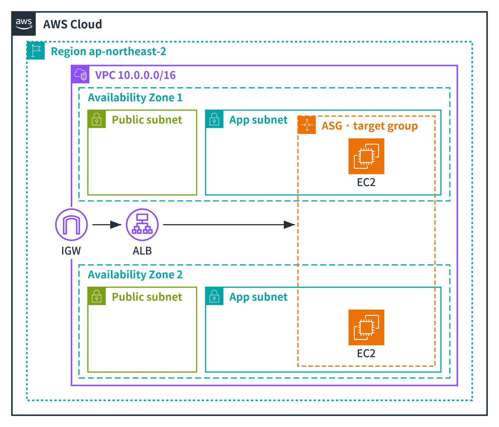
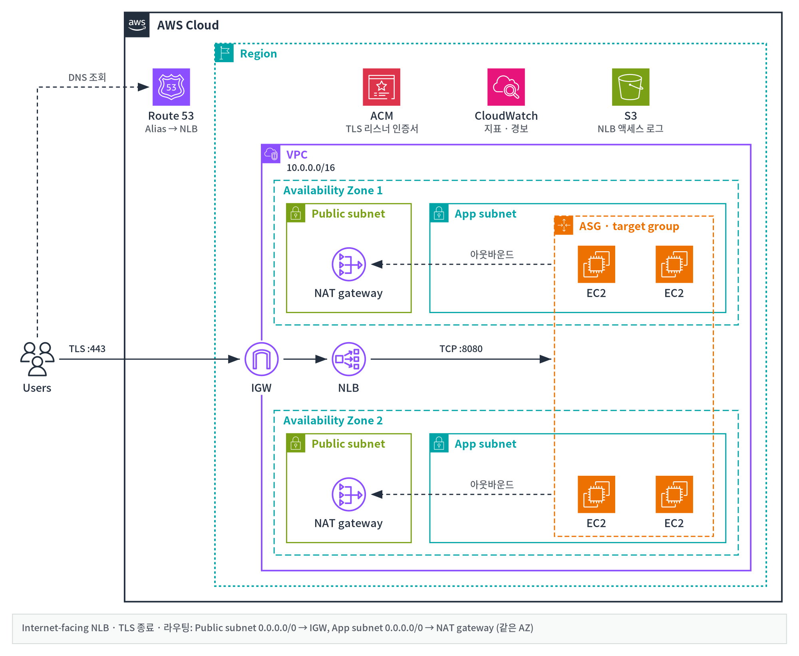
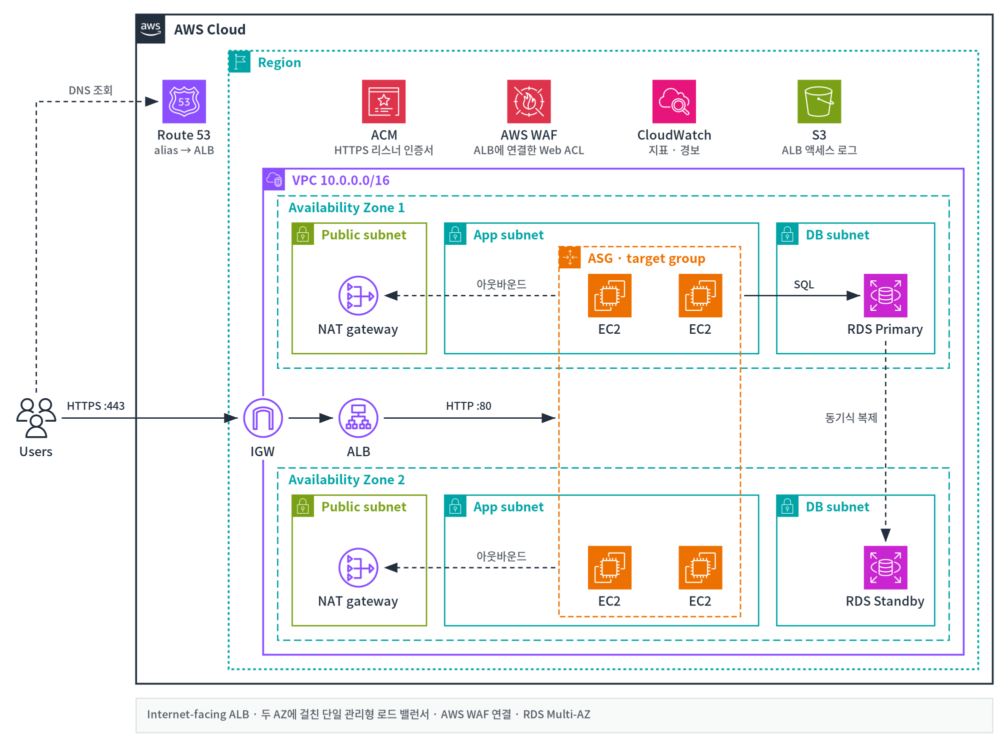
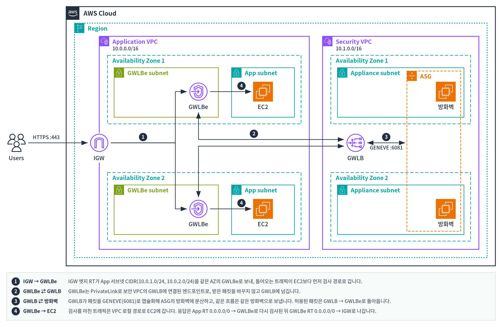
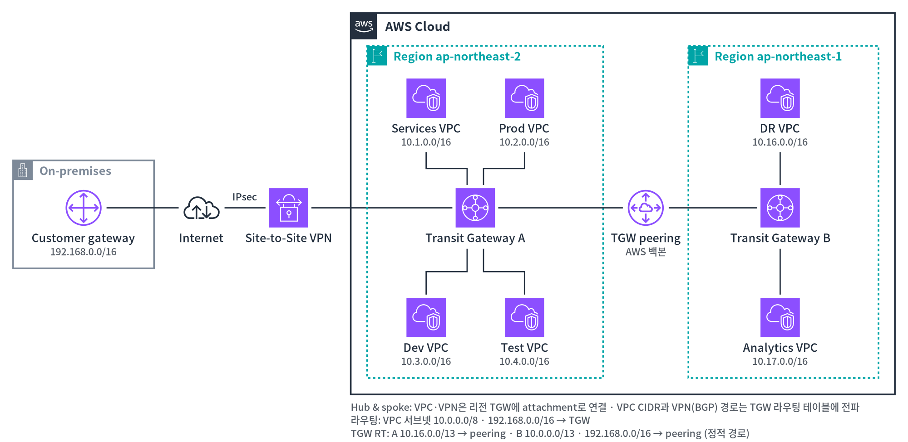
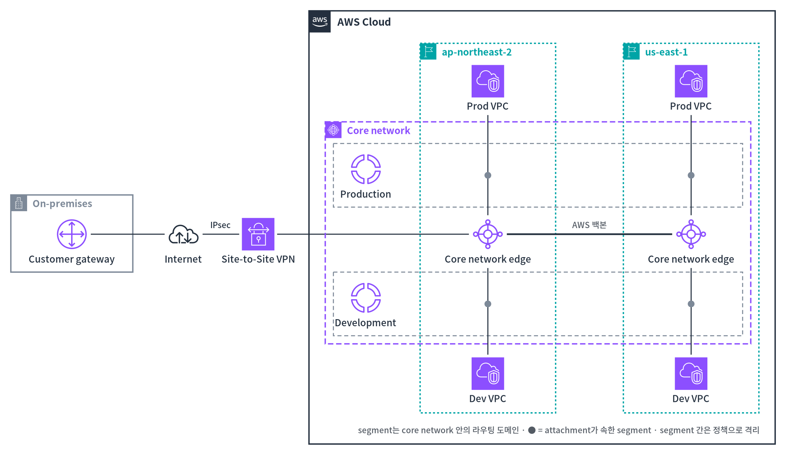

# skill-aws-arch-diagram

> English: [README.en.md](README.en.md)

**공식 AWS Architecture Icons**로 AWS 아키텍처 구성도를 그리는
[Claude Code](https://claude.com/claude-code) skill입니다. 손으로 흉내 낸 아이콘이나
텍스트 박스 대신 실제 서비스·리소스·그룹 아이콘을 쓰고, 하나의 레이아웃에서
독립 실행되는 **SVG**, **PNG**, 편집 가능한 도형으로 된 **PowerPoint 덱**을 원하는 조합으로
만듭니다.



지키는 규칙:

- 모든 서비스와 **모든 네트워킹 리소스**(Internet gateway, NAT gateway, VPC 엔드포인트,
  라우팅 테이블, 로드 밸런서)를 공식 아이콘으로 그립니다. 아이콘은 기억에 의존하지 않고
  번들로 포함한 아이콘 패키지에서 이름으로 찾습니다.
- AWS의 중첩 규칙(AWS Cloud > Region > VPC > 서브넷)을 따르고, 그룹 테두리 색과 점선
  모양은 공식 패키지와 PowerPoint 툴킷에서 가져옵니다. 아이콘이 없는 그룹(Availability
  Zone, 보안 그룹)도 포함합니다.
- 모든 노드의 아이콘 크기는 하나로 통일합니다. Internet gateway와 가상 프라이빗 게이트웨이는
  VPC 경계선 위 가운데에 두고, 아이콘과 라벨 뒤의 경계선은 가립니다.
- 트래픽은 왼쪽에서 오른쪽으로 흐릅니다(티어는 열, AZ는 행). ALB/NLB/GWLB는 AZ에 걸친
  노드 하나로 그리고, AZ별 리소스는 AZ마다 그립니다. 경로가 돌아가면 단계 번호를 붙입니다.
- 공식 그룹 스타일(직각 모서리), 내용에 맞춘 컨테이너, 읽기 쉬운 14px/12px 글자를 씁니다.
- 초안은 PowerPoint 도형과 1:1로 대응하는 SVG 부분 집합(rect, image, text, line,
  polyline, circle)으로 그리고, 내보내기 전에 선이 라벨이나 아이콘을 지나가는지 검사합니다.
- `export.py`는 원하는 형식을 조합해 씁니다: 모든 아이콘을 base64로 넣은 SVG, PNG,
  그리고 컨테이너·연결선·라벨은 PowerPoint 도형이고 아이콘은 공식 SVG인 16:9 덱입니다.
  슬라이드 글자는 10pt 이상으로 유지합니다(피할 수 없을 때만 8pt까지).

## 참조 예제

[`docs/examples/`](docs/examples/)에 이 skill로 그린 완성 구성도(SVG + PNG)가 있고, 새 구성도의
시작 레이아웃으로 씁니다. [`reference-architectures.pptx`](docs/examples/reference-architectures.pptx)에는
같은 다섯 개가 슬라이드로 들어 있고, 슬라이드별 렌더는 [`docs/examples/slides/`](docs/examples/slides/)에 있습니다.

| NLB | ALB |
|---|---|
|  |  |
| 인터넷 대상 NLB, TLS 리스너, 두 AZ에 걸친 ASG 대상 그룹 | 3-tier: AWS WAF를 붙인 ALB, 앱 ASG, RDS Multi-AZ |

| GWLB | Transit Gateway |
|---|---|
|  |  |
| 분산 검사: AZ별 GWLBe, 보안 VPC의 GWLB 하나와 방화벽 ASG | 리전 간 TGW peering으로 연결한 두 리전의 hub and spoke, 인터넷을 거치는 Site-to-Site VPN으로 온프레미스 연결 |

| AWS Cloud WAN |
|---|
|  |
| 하나의 글로벌 코어 네트워크: 리전마다 코어 네트워크 엣지, 리전에 걸친 Production / Development 세그먼트, Site-to-Site VPN으로 온프레미스 연결 |

## 설치

```bash
git clone https://github.com/conft2k/skill-aws-arch-diagram ~/.claude/skills/skill-aws-arch-diagram
```

다른 곳에 clone한 뒤 `~/.claude/skills/skill-aws-arch-diagram`으로 심볼릭 링크를 걸어도
됩니다. Claude Code를 다시 시작하면 "AWS 아키텍처 그려줘", "이 VPC 구성도 그려줘",
"이 구성도를 PPT 장표로 만들어줘", "draw the AWS architecture for …" 같은 요청에서
skill이 동작합니다.

AWS 아이콘은 이 저장소에 들어 있지 않습니다. 스크립트가 아이콘을 처음 쓸 때 AWS에서 공식
패키지(약 14MB, URL과 SHA-256 고정)를 받아 `assets/icons.json`을 만듭니다. 미리 받아 두거나,
네트워크가 없는 환경에서 직접 받은 zip으로 만들려면:

```bash
python3 scripts/fetch_icons.py               # 또는: --zip Icon-package_07312026.zip
```

요구 사항: Python 3.9 이상. `find_icon.py`, `check_layout.py`, `embed.py`는 외부 패키지가
필요 없습니다. 내보내기는 `uv run --with python-pptx --with cairosvg`([uv](https://docs.astral.sh/uv/))로
실행하므로 전역 설치가 없습니다. PNG에 한국어 라벨을 그리려면 CJK 글꼴(예: Noto Sans CJK KR)이
설치되어 있어야 합니다. 덱은 PowerPoint 2016 이상 / Microsoft 365에서 SVG 아이콘을 벡터로
그리고, 그보다 오래된 뷰어는 함께 넣은 PNG를 보여 줍니다. 슬라이드 글꼴은 기본이 Arial과
맑은 고딕이며 `--font` / `--ea-font`로 바꿀 수 있습니다.

## 구성

```
SKILL.md                     skill 본문: 작업 순서, 규칙, 하지 말 것
references/diagram_guide.md  AWS 시각 문법, 그룹 색, VPC 리소스 표, 초안 문법과 골격,
                             레이아웃·글자 크기·글꼴 규칙
assets/icons.json            아이콘 857개를 담은 JSON 번들 (세트: service, resource,
                             group, category); 처음 쓸 때 만들며 커밋하지 않음
scripts/find_icon.py         이름으로 아이콘 찾기: `find_icon.py alb igw "s3 gateway endpoint"`
scripts/export.py            초안 -> SVG / PNG / PPTX 중 원하는 형식 (+ 슬라이드 미리보기);
                             모든 초안을 먼저 검사하고 하나라도 실패하면 아무것도 쓰지 않음
scripts/embed.py             bundle: 참조를 base64로 넣음; 모르는 참조·외부 참조와
                             모서리가 둥근 그룹 컨테이너에서 실패
scripts/svg2pptx.py          초안 -> 기본 도형으로 된 .pptx; 정확히 바꿀 수 없는 요소에서 실패
scripts/render_pptx.py       덱의 슬라이드마다 PNG로 렌더
scripts/check_layout.py      라벨·아이콘 위를 지나는 선, 겹친 라벨, 12px 미만 글자 검사
scripts/fetch_icons.py       고정한 AWS 아이콘 패키지를 받아 icons.json 만들기
scripts/build_bundle.py      압축을 푼 아이콘 패키지를 icons.json으로 묶기
```

### 스크립트 직접 쓰기

```bash
# 아이콘의 정확한 참조 이름 찾기
python3 scripts/find_icon.py ec2 "api gateway" igw nat "s3 gateway endpoint"
#   [ 95] service/Amazon-EC2
#   [ 85] resource/Amazon-VPC_Internet-Gateway
#   ...

# SVG 초안에서는 bundle: 방식으로 아이콘을 참조
#   <image href="bundle:service/AWS-Lambda" x="200" y="200" width="48" height="48"/>

# 레이아웃 검사 (문제가 있으면 exit 1과 함께 라벨·아이콘을 지나는 선, 겹침, 작은 글자를 출력)
python3 scripts/check_layout.py draft.svg

# 원하는 형식을 조합해 내보내기 (렌더·변환할 수 없는 요소가 있으면 exit 1과 함께 목록 출력)
uv run --with python-pptx --with cairosvg python scripts/export.py \
  a.draft.svg b.draft.svg --svg --png --out-dir out \
  --pptx out/deck.pptx --title "Slide A" --title "Slide B" --preview

# 형식 하나씩 만들기
python3 scripts/embed.py a.draft.svg a.svg
uv run --with python-pptx --with cairosvg python scripts/svg2pptx.py a.draft.svg -o deck.pptx
uv run --with python-pptx --with cairosvg python scripts/render_pptx.py deck.pptx deck-preview
```

## 아이콘 세트 업데이트

AWS는 대략 분기마다(1월, 4월, 7월 말) <https://aws.amazon.com/architecture/icons/>에 새
아이콘 패키지를 냅니다. 이 skill은 `Icon-package_07312026`에 고정되어 있습니다. 새 패키지로
옮기려면 `scripts/fetch_icons.py`의 `PACKAGE`, `URL`, `SHA256`을 고치고 다시 만듭니다.

```bash
python3 scripts/fetch_icons.py --force
```

새 패키지에서 빠진 서비스는 번들에서도 빠집니다. 다시 만든 뒤에는
`SKILL.md`의 패키지 날짜와 세트별 개수를 고치고, `references/diagram_guide.md`의 그룹 색을
다시 확인하세요(`SKILL.md`의 "Updating the icon set" 참고).

## 라이선스

skill의 코드와 문서는 Apache License 2.0을 따릅니다([LICENSE](LICENSE) 참고).

AWS Architecture Icons는 Amazon Web Services 소유이며, 이 저장소에 들어 있지 않고 위 라이선스의
**대상도 아닙니다**. `scripts/fetch_icons.py`가 사용자의 컴퓨터에서 AWS로부터 직접 받으며, 아이콘
사용에는 AWS 약관이 적용됩니다. 예제 SVG, PNG, 덱은 이 아이콘으로 그린 구성도입니다.
[NOTICE](NOTICE)를 참고하세요. 이 프로젝트는 AWS와 제휴 관계가 없고 AWS의 보증을 받지
않았습니다.
